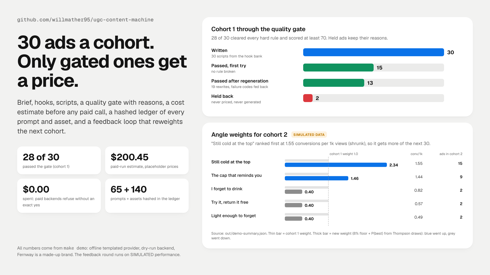
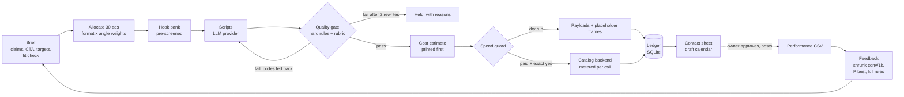
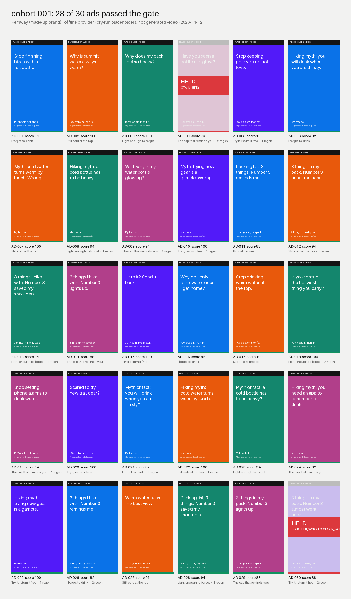

# ugc-content-machine

**A 30-ad short-form video cohort, written, checked, priced and logged before a cent is spent.**



> **What's real and what isn't**
>
> | Part | Status |
> |---|---|
> | Pipeline, quality gate, cost estimator, spend guard, ledger, feedback math, draft calendar | **Real, working code.** Tested (128 tests), runs offline. |
> | Ad copy in the demo | **Offline provider.** A seeded template engine, not a language model. It makes realistic mistakes on purpose so the gate has work to do. |
> | Brand | **Made up.** "Fernway Trail Bottle", its claims and its URL are fictional. |
> | Video, thumbnails, voice | **Dry run.** The exact request payloads are written to disk with a placeholder frame. Nothing is generated. |
> | Unit prices | **Placeholders, not verified.** `config/prices.toml` says `verified = false`, and paid runs refuse to start until that changes. |
> | Performance data in the feedback round | **SIMULATED.** Made by `ugcm/simulate.py` and labeled `SIMULATED` in every row, file name and report. |
> | Anthropic / OpenAI providers, pay-per-call catalog backend | **Wired, never called.** Request shapes are tested against fake transports. No key is in this repo. |

I built this to run a UGC ad test the way I'd want an agent to run it: a fixed brief, a hook bank, a hard quality gate with reasons, a cost estimate that prints first, a spend guard that needs an exact yes, a ledger you can audit, and a feedback step that changes the next brief based on conversions rather than views.

## Where it sits in the agent stack

Cody Schneider's frame for a working marketing agent is TRUTH (live warehouse data), HANDS (APIs behind limits), a HOME (runs on a schedule) and TOOLS. This repo supplies:

- **TOOLS:** yes. One CLI an agent can call: `run`, `simulate`, `feedback`, `verify`.
- **HANDS, behind limits:** yes, in shape. Generation goes through a backend interface. The paid adapter cannot send without verified prices, an exact `--approve-spend`, a hard cap and a per-call budget meter.
- **Self-improving loop:** yes. Performance in, new angle and format weights out, next brief written.
- **TRUTH:** no. Performance comes from a CSV. In production it would come from a warehouse such as [marketing-warehouse](https://github.com/willmather95/marketing-warehouse).
- **HOME:** no. It is a CLI. A scheduler (cron or an agent host) would run it weekly. Posting stays manual by design.

## Quickstart

Python 3.11 or newer. No API keys, no network, no install step for the core.

```bash
git clone https://github.com/willmather95/ugc-content-machine && cd ugc-content-machine
pip install pillow          # optional: PNG thumbnails and contact sheet (SVG is always written)
make demo                   # or: python -m ugcm demo --out out
make test                   # or: python -m unittest discover -s tests -t . -v
```

`make demo` takes under 2 seconds on my machine and writes:

```
out/
  cohort-001/
    ads/AD-001 ... AD-030/     script.md, script.json, gate.json, requests/{video,image,voice}.json, frame.svg, thumb.png
    contact-sheet.png/.svg     all 30 ads, held ones greyed with their failure codes
    cost-estimate.md/.json     per ad and per cohort, printed before any paid step
    ledger.sqlite              every prompt, seed, response, gate result, asset hash, cost line
    calendar.DRAFT.csv         14-day draft calendar, max 2 posts a day per account
    owner-summary.md           counts, held ads with reasons, the yes/no approvals needed
    hook-bank.json             every hook, with its pre-screen result
    performance.SIMULATED.csv  made-up results for the demo feedback round
    feedback-report.md         ranked angles, formats, emotions, hooks; old and new weights
  cohort-002.brief.json        the reweighted brief written by the feedback step
  cohort-002/                  the next 30 ads, built from that brief
  demo-summary.json            source for docs/hero.png
```

`make hero` re-renders `docs/hero.png` from `out/demo-summary.json` with headless Chrome.

## How it works



1. **Brief.** `config/brief.json` holds the brand, the exact CTA, the approved claims word for word, the targets written before launch, 3 formats, 5 angles and their weights. If fewer than 3 of 5 fit checks pass, or the claim list is empty, the run stops.
2. **Allocate.** 30 ads are split across format x angle cells with the largest-remainder method, so counts always sum to 30. Cells are interleaved so the calendar doesn't run one format for days.
3. **Hook bank.** At least 4 hooks per cell (20 per format), more where a cell needs more. Each hook is pre-screened for length and first frame before any script is written. No two ads in a cohort open on the same line when the bank has room (near-copies get grouped by platforms and lose reach).
4. **Scripts.** Every LLM call goes through one `LLMProvider` interface with a versioned prompt template (`hooks@3`, `script@4`).
5. **Gate.** Hard rules plus a 0 to 100 rubric. A failure carries a code, a reason, and the stage to redo. Hook failures swap the hook. Script failures go back to the provider as "avoid these" feedback. After 2 rewrites the ad is held.
6. **Estimate, then authorize.** Only passed ads are priced. The estimate prints and is written to disk before the spend guard runs.
7. **Generate.** Each passed ad becomes 3 requests: a 9:16 video chained from 8-second clips with the same reference image in every clip, a first-frame still, and a voiceover. On-screen numbers and captions are left to code, not the video model.
8. **Ledger, sheet, calendar.** Everything is hashed into `ledger.sqlite`. The calendar is drafts only.
9. **Feedback.** A performance CSV is ranked and the next brief is written with new weights.

## The quality gate

Rules live in `config/policy.toml`, not in Python.

| Code | Rule |
|---|---|
| `HOOK_TOO_LONG` / `HOOK_TOO_SHORT` | 3 to 10 words, said in 3 seconds or less at hook pace |
| `BLANK_FIRST_FRAME` | Frame one must show the product, a face or the payoff. Never black, blank or logo only |
| `HOOK_NOT_FIRST` | The first beat says the hook word for word |
| `TOO_SHORT` / `TOO_LONG` | 15 to 35 seconds at 2.6 spoken words a second |
| `CTA_MISSING` | The last beat says the exact CTA |
| `BANNED_CLAIM` | Health and hype patterns: cure, detox, burns fat, guaranteed, clinically proven, "best ever", #1, risk-free |
| `UNAPPROVED_CLAIM` | Any sentence that looks like a claim (a number with a unit, or keeps / holds / weighs / proven) must match an approved claim word for word. "Keeps water cold for 48 hours." fails when only "24 hours" is approved |
| `TESTIMONIAL_IMPLIED` | No "real customer", "real results", "verified buyer" from an AI person |
| `BRAND_SPELLING` / `BRAND_MISSING` / `FORBIDDEN_WORD` / `COMPETITOR_NAME` | Brand rules from the brief |
| `READABILITY` | Flesch-Kincaid grade 8 or lower, checked per beat so one stiff line can't hide in an average |
| `DISCLOSURE_MISSING` | AI label when AI-made, `#ad` for paid creators, the affiliate line for affiliate links |
| `TOO_MANY_HASHTAGS` / `CAPTION_TOO_LONG` | Max 5 hashtags; caption caps per platform (Shorts is 100) |
| `RUBRIC_LOW` | Rubric under 70. Weights: hook 30, clarity 20, proof 20, CTA 15, pacing 15 |

## Spend safety

A paid backend runs only when **all** of these hold:

1. `config/prices.toml` says `verified = true`. It ships as `false`, so a placeholder price can never be spent against.
2. `--approve-spend` equals the printed cohort estimate to the cent. Off by one cent is refused.
3. The estimate is under the hard cap (`max_cohort_usd = 250`).
4. Each call is charged against the approved amount **before** it is sent. The run stops at the line, not after it.

Any refusal exits with code 3, after the estimate is on disk and before any request is written. Real LLM providers also refuse without their key and without `--allow-network`.

```bash
python -m ugcm run --backend treg --approve-spend 1
# [4/7] cost estimate (before any paid step): paid-route total $200.45 for 28 ads  [PLACEHOLDER PRICES, verify before use]
# REFUSED (no spend): config/prices.toml is marked verified = false. These are placeholder prices. ...
```

## The ledger

`ledger.sqlite` has one row per prompt (template id and hash, seed, full prompt, response and its hash, tokens), per gate attempt, per asset (relative path, SHA-256, bytes, payload hash), per cost line and per feedback weight. Same brief, seed, policy and provider give the same fingerprint, and the tests check it. `python -m ugcm verify --cohort out/cohort-001` re-hashes every file on disk and fails if one byte changed.

Real models don't promise byte-identical output, so with a real provider the ledger is an audit trail, not a replay. The run row records `provider_deterministic`.

## The feedback loop

- **Metric:** attributed conversions per 1,000 views. Views without conversions are not a win.
- **Shrinkage:** each angle, format, emotion and hook gets a Beta prior centered on the cohort-wide rate (4,000 views of weight). Small samples can't top the table on luck.
- **P(best):** 4,000 seeded Thompson draws.
- **New weights:** an 8% exploration floor per group, the rest split by P(best), mean weight 1.
- **Kill rule from the brief:** after 10 posts, a format with median views under the floor **and** zero conversions gets weight 0. The floor and targets sit in the brief before launch and the code never moves them.
- **Output:** a report, ledger rows, and the next brief (`cohort-002.brief.json`) that the next run reads.

## Results

All numbers come from running `make demo` in this repo (offline provider, dry-run backend). The feedback numbers come from **SIMULATED** performance, so they show that the loop works, not that any angle wins in real life.

| Cohort 1 | |
|---|---|
| Ads written | **30**, 30 unique hooks |
| Passed the gate | **28**: 15 first try, 13 after a rewrite |
| Held back | **2**: one missing the exact CTA, one saying "cheap knockoff" |
| Rewrites | 19, each with the failure codes as feedback |
| First-attempt failures | BRAND_MISSING 5, TOO_SHORT 3, RUBRIC_LOW 3, BANNED_CLAIM 2, CTA_MISSING 2, DISCLOSURE_MISSING 2, FORBIDDEN_WORD 2, and 4 more codes once each |
| Median score of passed ads | 94 |
| Ledger | 65 prompts, 49 gate results, 140 hashed assets, 140 cost lines |
| Draft calendar | 84 rows across TikTok, Reels and Shorts, all `draft` |
| Spent | **$0.00** |

| Feedback round (SIMULATED) | |
|---|---|
| Posts / views / conversions | 84 / 192,515 / 183 |
| Conversions per 1k views | 0.951 against a target of 0.8 set before launch |
| Top angle | "Still cold at the top", 1.55 per 1k shrunk; weight 1.0 to 2.34 |
| Cohort 2 allocation | 15 ads on the top angle, 9 on the second, 2 each on the other three |
| Formats | All kept: none had 0 conversions. "3 things" had the lowest median views (860, under the 900 floor) but the best conversion rate, so it got more weight, not less |

Cohort 2 passed 29 of 30. It used 26 unique hooks: putting 15 ads on one angle ran past the fresh lines that angle's bank had, so 4 lines repeat. `unique_hooks` in the summary shows this so a person can widen the bank before posting.



### Cost estimate (placeholder prices)

For the 28 passed ads in cohort 1 on the draft video tier: video $132.00, re-roll allowance $46.20, voiceover $2.77, first-frame stills $1.12, script LLM $0.14, plus a 10% buffer = **$200.45** (about $6.51 an ad before the buffer). On the quality tier the same cohort estimates $527.15, which is over the $250 cap, so it would be refused. **These prices are placeholders and have not been checked against any provider.**

## Use a real model (optional)

```bash
cp .env.example .env          # add your own key; .env is git-ignored
export ANTHROPIC_API_KEY=...  # never commit it
python -m ugcm run --provider anthropic --allow-network --backend dryrun
```

Without `--allow-network` (or without the key) the provider refuses before building a connection. Generation stays on the dry-run backend unless you also verify prices and approve the exact spend.

## Safety and limits

- Nothing posts. The calendar is drafts, and the owner summary lists the yes/no approvals needed first.
- No AI person may imply a real customer, result or review, and AI-made videos carry the AI label.
- Claims must match the approved list word for word. Health, money and legal claims need that list, or the run stops.
- The gate catches what its rules describe. It does not judge taste, brand fit beyond its word lists, or whether a claim is true. A person still reviews the contact sheet.
- The readability score is a heuristic syllable count, good enough for a ceiling, not for fine ranking.
- The cost estimator multiplies the numbers you give it. It is only as right as `prices.toml`.

## Tests

```bash
make test        # or: python -m unittest discover -s tests -t . -v
```

128 offline tests cover every gate rule, the rubric, allocation, both providers (with fake transports), dry-run and catalog backends, the estimator (hand-checked math), every spend refusal, the per-call budget meter, ledger reproducibility and tamper detection, feedback ranking, shrinkage, kill rules, the CLI exit codes and the full demo. CI runs them on Python 3.11, 3.12 and 3.13, with and without Pillow.

## Layout

```
ugcm/
  brief.py          brief schema, fit check, claim-list stop
  allocate.py       largest-remainder split across format x angle
  prompts.py        versioned templates
  providers/        LLMProvider: offline (seeded), Anthropic, OpenAI
  gate.py           hard rules + rubric
  cost.py           price book, estimator, spend guard, budget meter
  generation/       GenerationBackend: dry run, pay-per-call catalog adapter
  ledger.py         SQLite ledger, fingerprint, verify
  render.py         placeholder frames, contact sheet
  calendar.py       draft calendar
  feedback.py       ranking, shrinkage, Thompson P(best), kill rules, next brief
  simulate.py       SIMULATED performance for the demo
  pipeline.py       the cohort run
  cli.py            python -m ugcm ...
config/             brief.json, policy.toml, prices.toml (placeholders)
fixtures/           hand-made performance CSV and ads for tests
scripts/            render_hero.py
tests/              offline tests
```

## Related repos

- [marketing-warehouse](https://github.com/willmather95/marketing-warehouse): the TRUTH layer this would read performance from.
- [conversion-tracking-agent](https://github.com/willmather95/conversion-tracking-agent): makes sure each conversion is counted once, so "conversions per 1k views" means something.
- [agent-ops-showcase](https://github.com/willmather95/agent-ops-showcase): how I run agents with one job each and a yes before anything ships.
- [world-class-charts](https://github.com/willmather95/world-class-charts): the chart style behind the hero image.

## License

MIT. Fernway, its claims, its URL and the competitor names in the brief are fictional.
